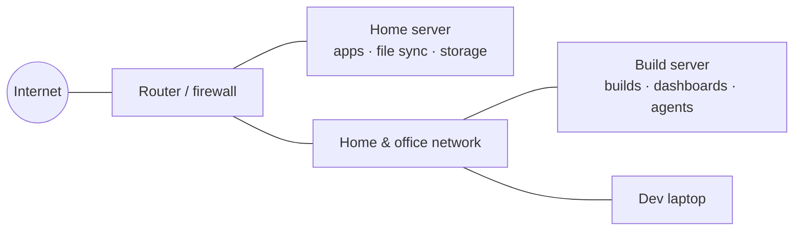

# Covenant Computers & IT — Homelab

This repository documents a small-business homelab: a home server and a
build server that run the business's apps, file storage and home network,
plus a fleet of five AI agents that runs day-to-day operations.

Everything here was written in October 2026 from a live audit of the
running systems. Anything that wasn't inspected directly is labelled as
such.

> **Publication note:** this repo is public. It describes the homelab by
> role and purpose. It does not include addresses, hostnames, network
> layout, software versions or access details. A secret scan runs before
> every push.

## At a glance

| | |
|---|---|
| Machines | Home server (always on), build/compute server, development laptop |
| Storage | Redundant disk array (survives two disk failures), holding self-hosted file sync |
| Services | Self-hosted file sync, two in-house business apps, a SaaS product, mail, network-wide ad blocking, push alerts and the business website |
| Network | Self-hosted routing and firewall. A move to a dedicated router appliance with network segmentation is underway |
| Operations | Five persistent Claude Code agents with defined roles, cross-agent delegation and a daily fleet audit |
| Power | UPS with automatic, coordinated shutdown across machines |

## Contents

| Document | What's in it |
|---|---|
| [content/hardware.md](content/hardware.md) | Hardware inventory |
| [content/network.md](content/network.md) | Network design principles and the planned segmentation |
| [content/services.md](content/services.md) | What runs, and what it's for |
| [content/agent-fleet.md](content/agent-fleet.md) | The AI agent fleet: roles, delegation, guardrails, daily audit |
| [content/monitoring-and-backups.md](content/monitoring-and-backups.md) | Monitoring, alerting and the backup rebuild |
| [content/projects-and-roadmap.md](content/projects-and-roadmap.md) | Active projects and the roadmap (mini rack, router appliance, backups) |
| [content/audit-2026-10.md](content/audit-2026-10.md) | October 2026 audit summary |
| [content/audit-build-server-2026-10.md](content/audit-build-server-2026-10.md) | Build-server audit (by Habakkuk), including the mini-rack design |
| [content/diagram.md](content/diagram.md) | Architecture diagrams (Mermaid) |

## Architecture (summary)

More diagrams, including the agent fleet, are in [content/diagram.md](content/diagram.md).

## Repository hygiene

- `scripts/prepush-scan.sh` runs before every push. It runs
  [gitleaks](https://github.com/gitleaks/gitleaks) over the full history,
  plus pattern checks for network identifiers and a local-only denylist.
- Real configuration files are never committed. This repo describes the
  setup; it doesn't contain it.
