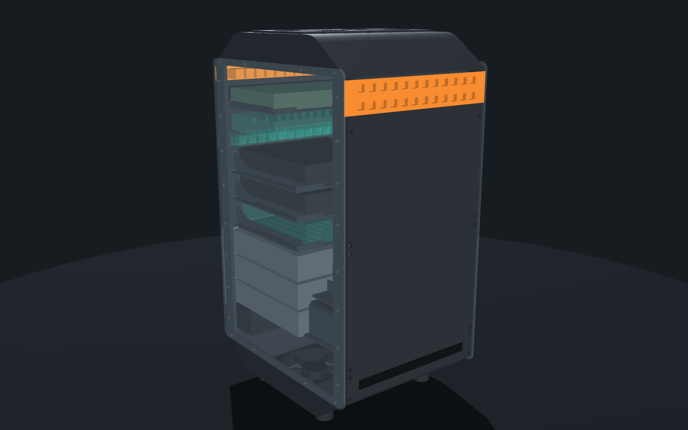
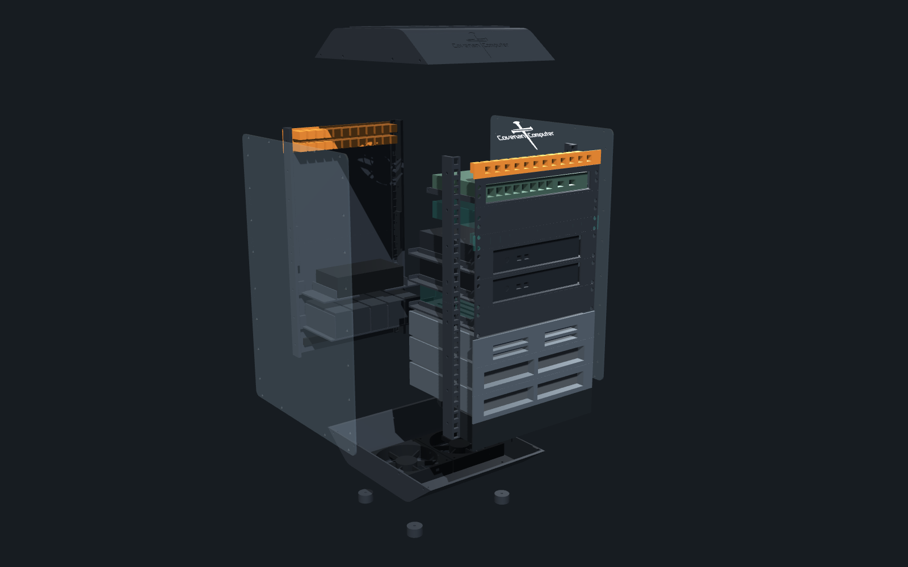

# Build server, October 2026

Summarized for publication from Habakkuk's live audit of the machine he
runs on. The full audit is kept privately.

## What this machine is

A desktop PC that doubles as the homelab's control node. It runs:
- a daily-use desktop
- three of the five persistent AI agents
- the fleet dashboards and voice control
- a build host for the CovenantOS embedded-Linux project
- the design workbench for the 3D-printed mini rack

| Item | Detail |
|---|---|
| CPU | AMD Ryzen 5, 6 cores / 12 threads |
| RAM | 32 GB |
| GPU | NVIDIA RTX, 6 GB |
| Storage | NVMe SSD (OS) plus a SATA SSD |
| OS | Debian Linux, KDE Plasma |
| Power | Clean automatic shutdown on long outages, coordinated with the home server's UPS |

## The agents hosted here

**Gabriel** (coordinator), **Habakkuk** (watchman) and **Oholiab**
(design) run here permanently.
- A boot-time service starts each agent, and it resumes the same
  conversation after any reboot.
- Each agent loads only its own instruction file, so two agents on one
  machine never pick up each other's rules.
- The fleet-wide guardrails are described in [agent-fleet.md](agent-fleet.md).

## Self-hosted tooling

- **Mission-control dashboard:** device health, watched services and
  agent activity from every machine.
- **Fleet Voice:** voice control of the coordinator agent. Speech-to-text
  and text-to-speech run locally on the CPU, so nothing goes
  to a cloud voice service. A confirm-before-send review step sits
  between speech and the agent.
- **Health watcher:** checks temperatures, memory, disk space and
  services every minute. It logs only state changes (ALERT and CLEARED),
  and pushes alerts to the owner's phone.
- **Sync watchdog:** detects a stalled file-sync client and restarts it,
  with a rate limit.

## Engineering note: GPU thermal hardening

- **Incident:** in September 2026, under a heavy dual-game load in a case
  with little airflow, the GPU dropped off the bus and the display went
  black.
- **Diagnosis:** thermal and power stress.
- **Fix:**
  - a boot-time power and clock cap
  - a thermal guard that lowers the power limit if the card throttles
  - a gaming-load watch that alerts and steps the limit down further
  - a 5-second telemetry log as evidence
- **Result:** no repeat since.

## The 10U 3D-printed mini rack

A 10-inch, 10U homelab rack, designed to be printed and assembled. It
holds a router mini PC, a home-server mini PC, a reserved security mini
PC, managed PoE switching, patch panels, a drive bay and a power strip.
The Wi-Fi access point sits outside the rack.

**Design**
- **Fully parametric:** one Python/CadQuery model generates every part,
  the assembly, an interference check, a parts list and the STL files.
  Change a dimension and everything regenerates.
- **Size:** 254 mm rails with a 222.25 mm opening, 10U rail window and
  325 mm rail depth. About 260 x 331 x 564 mm overall.
- **Hoods:** tapered top and bottom hoods carry the cooling fans, so the
  full rack volume stays free for equipment. The top hood carries the
  business logo as a white inlay.
- **Panels:** clear side panels; everything else is printed in solid
  black.
- **Phase two:** reserved slots are printed as blanks, so it needs no
  redesign.

**Verification**
- All 30 STL files are watertight and oriented to print.
- A solid-overlap check compares every printed part against every other
  part and every hardware mockup. It caught two real design bugs, both
  fixed before anything was printed.

**Status**
- **Ready to quote:** 30 files and 36 pieces, about 3 L of plastic. Most
  parts fit a 256 mm print bed; the two hoods and two side panels need a
  large-format printer.
- **Not started:** nothing has been printed, quoted or ordered yet.
- **Hardware estimate:** about USD 4.3k for the home phase and 4.2k for
  the security phase. These are web-search estimates and don't include
  printing.
