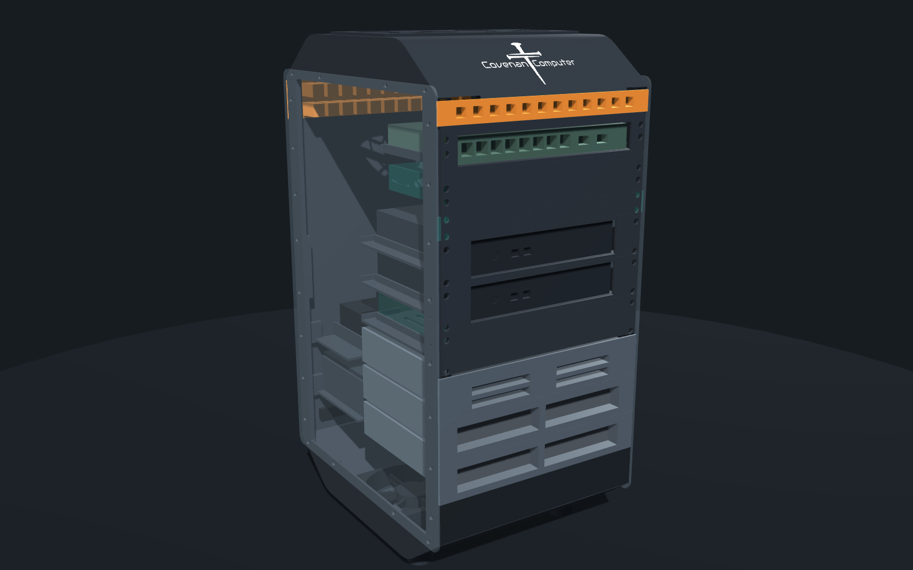

# Projects and roadmap

## Active software projects

| Project | What it is | Built with | Status (Oct 2026) |
|---|---|---|---|
| Business website | The company's public marketing site | Static HTML/CSS/JS with no build step, self-hosted font, an accessible 3D hero with reduced-motion fallbacks | **Live.** The revamp launched in October 2026 and passed its post-launch accessibility and layout tests |
| LazarusOS | Internal business management app: tickets, invoices, customers, checklists, tools | Node/Express with SQLite, vanilla JS on a shared design-token CSS system. Runs as a PWA, a desktop app and a mobile app | **In daily use.** New terminal-style theme shipped in October 2026 |
| MotorLog | Vehicle and equipment maintenance logging and reminders; a separate venture with paying users | Node/Express with SQLite, a vanilla JS PWA, the shared design system | **Beta and production channels.** Every release goes through a written beta-to-production procedure |
| Client church website | Church site with a staff admin area | A TypeScript/React web app in containers | **Release candidate audited and passed.** Waiting for its production hardware |
| Router admin interface | Self-hosted web admin for the house router | Static, works fully offline | **Live.** Changes are staged, reviewed, and roll back automatically unless confirmed |
| CovenantOS | Experimental Debian-based phone OS (GPL) | Debian packaging, cross-built images, emulator smoke tests | **Phase 1 (foundation).** A signed package archive is hosted on the home server; builds run on the build server |

## Roadmap (priority order)

### 1. Rebuild the backup system
Versioned local backups, an encrypted off-site copy, restore tests and
alerting. See [monitoring-and-backups.md](monitoring-and-backups.md#backups).

### 2. 10U printed mini rack
Designed by Habakkuk.

| Part | Plan |
|---|---|
| Compute | Three identical small-form-factor mini PCs: router, home server, and a reserved security PC |
| Router | Multi-port network card in the expansion slot |
| Home server | 32 GB RAM, 1 TB NVMe, a disk controller for direct disk access |
| Drive bay | 3U, holding 4 x 3.5" HDDs and 4 x 2.5" SSDs on their own power supply |
| Switching | Managed PoE+ switches: one for the home network, plus a reserved slot for cameras |
| Power | 10" power strip fed from the UPS |
| Wi-Fi | Multi-network PoE ceiling access point, outside the rack |

- **Parametric design:** one Python/CadQuery model generates every part,
  the assembly, an interference check, the parts list and all 30 STL
  files. The interference check caught two real design bugs before
  anything was printed.
- **Shape:** tapered top and bottom hoods carry the cooling, which leaves
  the full rail space for equipment. Reserved slots are printed as blanks,
  so phase two needs no redesign.
- **Status:** designed and quote-ready. Nothing has been printed, quoted or
  ordered yet.
- **Estimated hardware cost:** about USD 4.3k for the home phase and 4.2k
  for the security phase. These are web-search estimates and don't
  include printing.
- The current home server stays on as a fallback once the new one takes
  over.

### 3. Dedicated router appliance
Routing moves to a dedicated router appliance, so server maintenance and
network uptime no longer depend on each other. The current setup is kept
as a tested fallback.

### 4. Network segmentation
Separate segments for work devices, smart-home devices, guests and
cameras. See [network.md](network.md).

### 5. Security cameras
- A local NVR runs on the reserved security mini PC, using hardware video
  decode and object detection.
- Recordings stay on dedicated local storage.
- Viewing is private, with no cloud service.

### 6. Storage refresh
The new home server gets new, larger drives. The data is copied over and
verified before the current array is retired.

## Done in 2026 (highlights)
- Self-hosted routing, with an admin interface that stages changes and
  rolls them back automatically.
- Coordinated UPS shutdown across machines.
- The agent fleet, with shared memory, a daily audit and push alerting.
- Business website revamp, plus new themes for LazarusOS and the router
  interface, each shipped through a verified, backed-up deploy.
